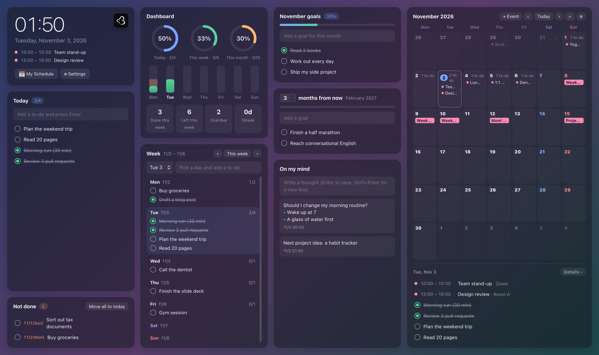
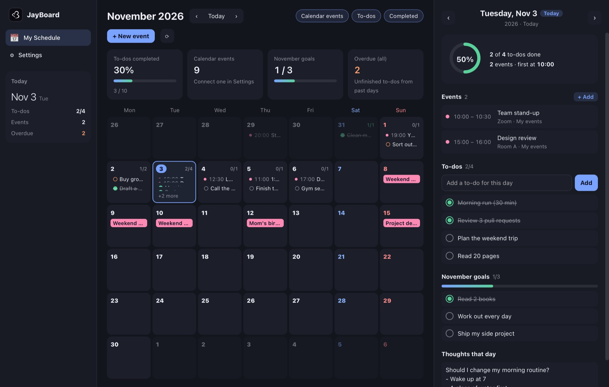
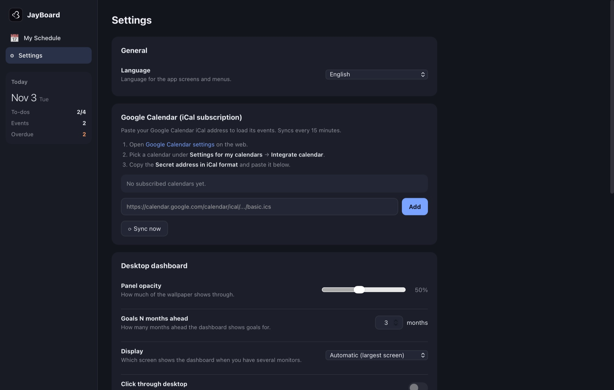

  

<h1 align="center">JayBoard</h1>

  <b>Your to-dos, goals and Google Calendar — right on your desktop wallpaper.</b> 
  Free for macOS and Windows.

  <a href="https://github.com/jaykang-dev/JayBoard-download/releases/latest/download/JayBoard-mac.dmg"><b>⬇ Download for Mac</b></a>
  &nbsp;·&nbsp;
  <a href="https://github.com/jaykang-dev/JayBoard-download/releases/latest/download/JayBoard-windows-x64.exe"><b>⬇ Download for Windows</b></a>
  &nbsp;·&nbsp;
  <a href="https://github.com/jaykang-dev/JayBoard-download/releases">All versions</a>

---

## What it does

JayBoard sits on your desktop, underneath all your windows, so you see your day every time you look at your desktop.

- **Today** – a quick to-do list for today. Check things off as you go.
- **Not done** – to-dos left over from past days, with one click to move them to today.
- **Dashboard** – how much you finished today, this week and this month, plus your streak.
- **Week** – plan to-dos for each day of the week.
- **Monthly goals** and **goals N months from now** – keep the bigger picture in view.
- **On my mind** – a scratchpad for ideas and thoughts.
- **Calendar** – a month view with your **Google Calendar** events and your to-dos.
- **My Schedule** – a full window to browse each month, open any day and see everything for that day.
- **Make it your layout** – move, resize and hide widgets. Widgets in the way slide aside and always stay on your screen.
- **Edit in place** – click any to-do, goal or note to change it. Click a calendar day to add an event.
- Korean and English, light on resources, and your data never leaves your computer.

| My Schedule | Settings |
|---|---|
|  |  |

---

## Install

### Mac
*macOS 13 Ventura or later · Apple Silicon and Intel*

1. Download **[JayBoard-mac.dmg](https://github.com/jaykang-dev/JayBoard-download/releases/latest/download/JayBoard-mac.dmg)** and open it.
2. Drag **JayBoard** into the **Applications** folder.
3. Open JayBoard from Applications.

> **"JayBoard can't be opened" / "unidentified developer"?** This only happens the first time.
> 1. Click **Done** (or **Cancel**) in the warning.
> 2. Open **System Settings › Privacy & Security**, scroll down and click **Open Anyway** next to JayBoard.
> 3. Click **Open** and enter your Mac password.
>
> On macOS 14 or earlier you can also **Control-click** JayBoard in Finder and choose **Open**.

### Windows
*Windows 10 or 11, 64-bit*

1. Download **[JayBoard-windows-x64.exe](https://github.com/jaykang-dev/JayBoard-download/releases/latest/download/JayBoard-windows-x64.exe)**.
2. Move it to any folder you like (for example `Documents`) and double-click it. There is no installer — this one file is the whole app.

> **"Windows protected your PC"?** This only happens the first time.
> Click **More info**, then **Run anyway**.
>
> If you're asked to install the **WebView2 Runtime**, follow the link to Microsoft's page, install it and start JayBoard again.
> (It's already included in Windows 11 and up-to-date Windows 10.)

---

## Getting started

When JayBoard starts, the dashboard appears on your desktop and the **My Schedule** window opens.

### 1. Connect Google Calendar (optional)
JayBoard reads your calendar through its private iCal address. You don't need to sign in to Google in the app.

1. Open [Google Calendar settings](https://calendar.google.com/calendar/r/settings) in your browser.
2. On the left, under **Settings for my calendars**, click the calendar you want.
3. Go to **Integrate calendar** and copy the **Secret address in iCal format**.
4. In JayBoard, open **Settings › Google Calendar**, paste the address and click **Add**.

Repeat for each calendar you want to see. Events refresh every 15 minutes (click **⟳** to refresh now).

> Keep this address private — anyone who has it can see your calendar.

### 2. Add to-dos, goals and thoughts
Type into any box on the dashboard and press **Enter**.
- Click the circle to mark something done. Hover and click **×** to delete.
- **Click the text** of a to-do, goal or note to edit it right there. **Enter** saves, **Esc** cancels
  (in notes, **Shift+Enter** adds a new line).
- In **Week**, pick a day first, then type the to-do.

### 3. Add your own events
Hover over a day in the calendar and click **+**, or **double-click** the day. You can also use **+ Event**,
**+ Add event** under the selected day, or **+ New event** in My Schedule.
Your own events can be edited and deleted by clicking them.

Google Calendar events are read-only in JayBoard. Click one to see its details, then:
- **Edit or delete in Google Calendar** opens it in your browser. Changes show up in JayBoard on the next sync.
- **Hide in this app** removes it from JayBoard only. (Bring hidden events back in **Settings**.)

### 4. Arrange your widgets
**Right-click** the dashboard and choose **Edit widgets** (or press **⌥⌘E** on Mac, **Ctrl+Alt+E** on Windows,
or use *Edit Widgets* in the menu bar / notification area icon).
- **Drag** a widget to move it. **Drag the bottom-right corner** to resize it.
- Widgets in the way slide aside or shrink a little so everything stays on your screen.
- **Hide** widgets you don't use; bring them back from the right-click menu.
- Click **Done**, press **Esc** or click an empty spot to finish. **Reset to default layout** is in the right-click menu.

### 5. Make it yours (Settings)
| Setting | What it does |
|---|---|
| **Language** | Korean or English (or follow your system) |
| **Panel opacity** | How much of your wallpaper shows through |
| **Goals N months ahead** | How far ahead the second goal panel looks |
| **Display** | Which monitor shows the dashboard: the largest, all of them, or a specific one |
| **Click through desktop** | Lets clicks pass through the dashboard so you can use your desktop icons |
| **Open at login** / **Start with Windows** | Start JayBoard automatically when you turn on your computer |
| **Export / Import** | Back up your data or move it to another computer (Mac ↔ Windows works) |

---

## Keyboard shortcuts

| Action | Mac | Windows |
|---|---|---|
| Edit widgets | ⌥⌘E | Ctrl+Alt+E |
| Open My Schedule | ⌘1 | Ctrl+1 |
| Open Settings | ⌘, | Ctrl+, |
| Toggle click-through | ⌥⌘T | Ctrl+Alt+T |
| Reload | ⌘R | Ctrl+R |
| Export / Import data | ⇧⌘E / ⇧⌘I | Ctrl+Shift+E / Ctrl+Shift+I |

On Mac, JayBoard also has an icon in the menu bar. On Windows, it's in the notification area (bottom-right, near the clock) — double-click it to open My Schedule.

---

## FAQ

**How do I move or resize widgets?**
Right-click the dashboard and choose **Edit widgets**. See [Arrange your widgets](#4-arrange-your-widgets).

**I can't click my desktop icons.**
Turn on **Click through desktop** (Mac ⌥⌘T, Windows Ctrl+Alt+T). Turn it off again when you want to type into the dashboard.

**The dashboard is on the wrong monitor.**
Choose a monitor in **Settings › Display**.

**I closed the window. Is JayBoard still running?**
Yes — closing My Schedule only hides it. Open it again from the menu bar icon (Mac), the notification area icon (Windows) or the Dock. To quit, use **Quit JayBoard** in the menu.

**My calendar doesn't show recent changes.**
Click **⟳** to sync now. Google can take a few minutes (occasionally longer) to update the iCal address.

**Where is my data stored?**
Only on your computer:
- Mac: `~/Library/Application Support/JayBoard/`
- Windows: `%APPDATA%\JayBoard\`

JayBoard has no account and sends nothing to any server. The only thing it downloads is your calendar from the iCal address you added.

**How do I update?**
Download the latest version from this page and replace the old one (Mac: drag it into Applications again; Windows: replace the `.exe`). Your data is kept.

**How do I uninstall?**
Turn off *Open at login* / *Start with Windows*, quit JayBoard, then delete the app (Mac: move JayBoard from Applications to the Trash; Windows: delete the `.exe`). To remove your data too, delete the data folder above.

---

## Feedback

Found a bug or have an idea? [Open an issue](https://github.com/jaykang-dev/JayBoard-download/issues) or email **jaykang.dev0@gmail.com**.

## License

JayBoard is **free to download and use**. Copying, modifying, redistributing, selling or reverse engineering it is not allowed.
See [LICENSE.txt](LICENSE.txt) for the full terms.

© 2026 Jay.k. All rights reserved.
